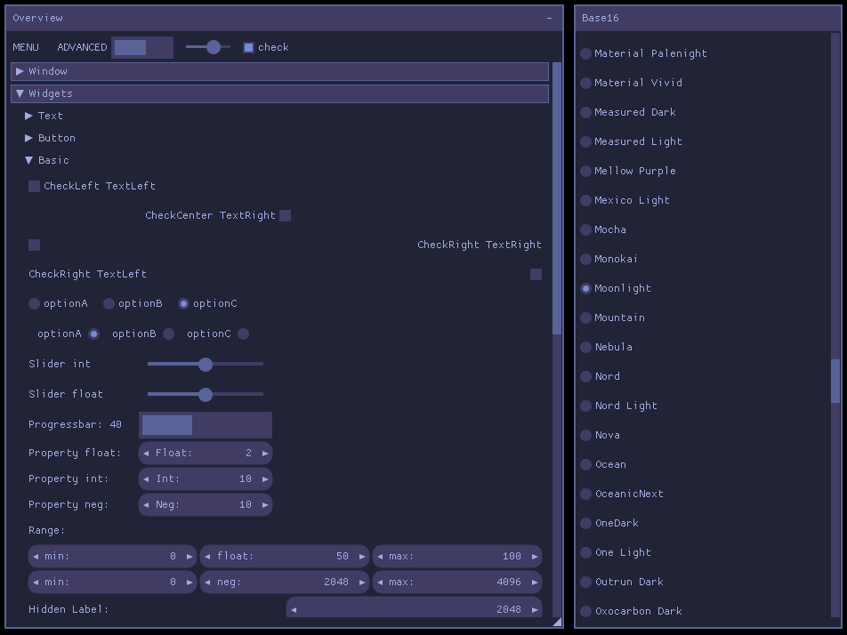

# nuklear_tinted

[Tinted Theming](https://github.com/tinted-theming/home) styles for [Nuklear](https://github.com/Immediate-Mode-UI/Nuklear). Over 500 Base16 and Base24 color styles to apply to your Nuklear GUI.

## Screenshot



## Setup

The scheme data comes from the [tinted-c](https://github.com/RobLoach/tinted-c) submodule, so clone recursively:

``` sh
git clone --recursive https://github.com/RobLoach/nuklear_tinted.git
# Or, in an existing clone:
git submodule update --init
```

## Usage

Include `nuklear.h` first, then define `NK_TINTED_IMPLEMENTATION` in exactly one source file before including `nuklear_tinted.h`. Include the [tinted-c](https://github.com/RobLoach/tinted-c) schemes you use, with `TINTED_IMPLEMENTATION` to compile their data:

``` c
#include "nuklear.h"

#define NK_TINTED_IMPLEMENTATION
#include "nuklear_tinted.h"

#define TINTED_IMPLEMENTATION
#include "vendor/tinted-c/include/base16-dracula.h"

nuklear_tinted_set_scheme(ctx, &base16_dracula);
```

To have every scheme, include `tinted.h`, which provides them as `tinted_schemes`, with `TINTED_COUNT` entries:

``` c
#define TINTED_IMPLEMENTATION
#include "vendor/tinted-c/include/tinted.h"

for (int i = 0; i < TINTED_COUNT; i++) {
    printf("%s\n", tinted_schemes[i]->name);
}
```

## Demos

``` sh
# SDL2
make -C demo/sdl
./demo/sdl/nuklear_tinted_sdl

# SDL3
make -C demo/sdl3_renderer
./demo/sdl3_renderer/nuklear_tinted_sdl3_renderer

# raylib
cmake -S demo/raylib -B build
cmake --build build
./build/nuklear_tinted_demo_raylib
```

## Dependencies

- C99, or C++20
- [tinted-c](https://github.com/RobLoach/tinted-c) C Headers for Base16 and Base24
- [Nuklear](https://github.com/Immediate-Mode-UI/Nuklear) GUI

## License

[MIT](LICENSE)
